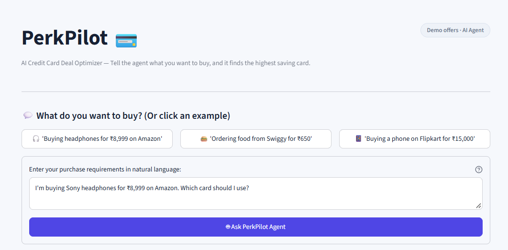
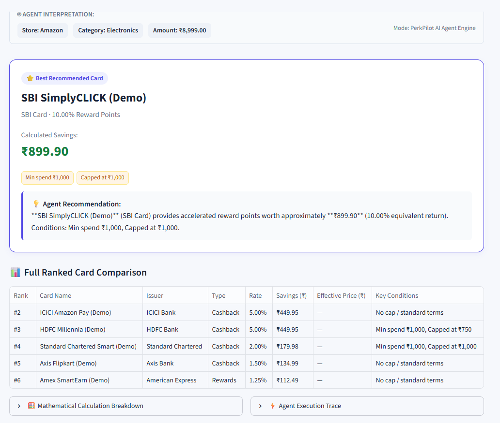
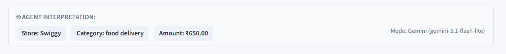

# PerkPilot 💳 — Smart Money, Calm UI
  
> An AI-powered credit card optimizer that pairs Google ADK and Gemini with a deterministic SQLite-backed calculation engine to find shoppers the single best card for any purchase.

---

## 1. Overview

Shoppers frequently leave money on the table because credit card benefits, reward caps, minimum-spend exclusions, and instant discounts are fragmented across disparate terms. 

**PerkPilot** solves this by:
1. Validating the purchase details (merchant, category, and amount).
2. Querying a local SQLite database of credit card offers (with exact and wildcard matching).
3. Deterministically calculating exact cashback, rewards, caps, and effective discount prices using Python's `Decimal` arithmetic.
4. Synthesizing a clear, scannable recommendation explaining why the card won, with all key conditions visible.

---

## 2. Visual Walkthrough & UI Reference

### Natural Language Prompt Interface
Shoppers simply describe what they want to purchase in free-form plain English. No manual dropdowns or numeric steppers required:



### Recommendation & Ranked Comparison Dashboard
The AI Agent interprets the intent, calls the SQLite calculation engine, highlights the winning card with exact calculated savings, and displays a full ranked comparison:



### Live Gemini Model Execution
The agent autonomously parses natural language and executes tool queries live using `gemini-3.1-flash-lite`:



---

## 3. Tech Stack

- **UI:** [Streamlit](https://streamlit.io/) with custom styling following the `ui-theme.md` design system.
- **Agent Framework:** [Google ADK](https://github.com/google/adk) / Google GenAI.
- **Persistence:** SQLite (`sqlite3` standard library with foreign key enforcement).
- **Financial Math:** Pure Python `Decimal` with rounding precision (`ROUND_HALF_UP`).
- **Testing:** `pytest` for unit, repository, and service test suites.

---

## 4. Quickstart

### Prerequisites
- Python 3.11+
- Git

### Installation

```bash
# 1. Clone repository and navigate inside
cd CC_Deal_optimiser

# 2. Create virtual environment
python -m venv .venv

# 3. Activate virtual environment
# Windows PowerShell:
.\.venv\Scripts\Activate.ps1
# macOS/Linux:
# source .venv/bin/activate

# 4. Install dependencies
pip install -r requirements.txt

# 5. Configure environment variables (optional for live Gemini agent)
cp .env.example .env
```

### Initialize Database
The database initializes and seeds automatically on first run, or you can run:
```bash
python -m db.seed_db
```

### Run Tests
```bash
pytest
```

### Launch Streamlit App
```bash
streamlit run app.py
```

---

## 5. Architecture & Guardrails

- **Math is Deterministic:** The LLM never computes or alters financial figures. Calculations are strictly executed by `services/calculations.py`.
- **Zero Hallucinated Offers:** Offers and cards are queried exclusively from the database repository.
- **Prompt-Injection Resistant:** User inputs and database text are treated as passive data strings, never as instructions.
- **Deduplication:** When a card matches multiple offers (e.g. an Amazon-specific offer and a generic base offer), the single highest net benefit offer for that card is selected.
- **Instant Discount vs Cashback:** Instant discounts reduce checkout price immediately; cashback and reward points are reported separately as post-purchase returns.
